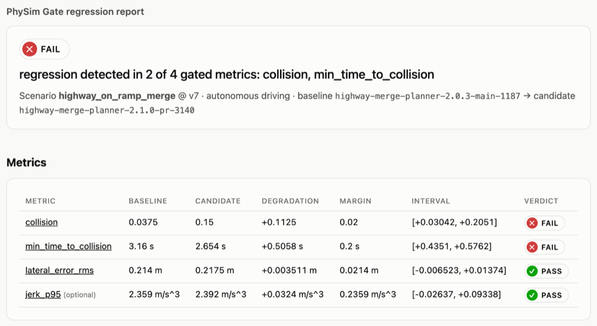
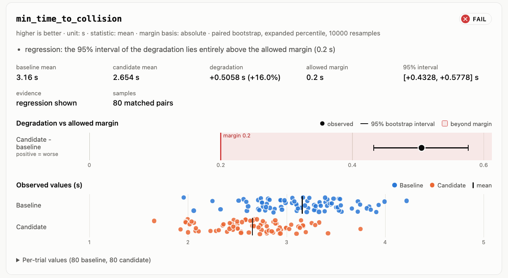

# PhySim Gate

**Test physical AI like software. Catch behavioral regressions before deployment.**

PhySim Gate is a small, simulator-agnostic regression gate for robotics, embodied AI, autonomous driving and aerial systems.
You give it the results of a baseline run and a candidate run.
It decides, metric by metric, whether the candidate behaves worse than allowed.
It explains why, writes evidence your CI can keep, and exits with a code your pipeline can act on.

It does not run your simulator, generate scenarios, or host anything.
It reads result files that your existing simulation jobs already produce.

```text
your sim job ──> baseline.json ─┐
                                ├─> physim-gate compare ──> verdict + exit code
your sim job ──> candidate.json ┘          │                 comparison.json
                    gate.yaml ─────────────┘                 junit.xml, report.html
```

## Contents

- [The problem](#the-problem)
- [How PhySim Gate differs](#how-physim-gate-differs)
- [Quickstart (no GPU, no simulator)](#quickstart-no-gpu-no-simulator)
- [Example inputs](#example-inputs)
- [Example report](#example-report)
- [How the verdict is reached](#how-the-verdict-is-reached)
- [Statistical limitations](#statistical-limitations)
- [CI usage](#ci-usage)
- [Writing an adapter](#writing-an-adapter)
- [Python API](#python-api)
- [Supported and not supported](#supported-and-not-supported)
- [Roadmap](#roadmap)
- [Contributing and license](#contributing-and-license)

## The problem

A change to a grasp policy, a motion planner or a flight controller can pass every unit test and still make the system behave worse.
Simulation is where teams catch that, but the comparison step is usually ad hoc.
Someone eyeballs two dashboards, or a script checks that a mean did not drop by more than 5%.

Both approaches fail in predictable ways:

- **Noise looks like a regression, or hides one.** Physics engines, sensor models and learned policies are stochastic. Thirty episodes of a 90% success policy can easily show 83% or 97%.
- **Missing data hides failures.** If crashed episodes drop out of the average, a policy that crashes more often can look better.
- **Results are not reproducible.** Nobody recorded which simulator version, seed list or commit produced the baseline.
- **CI cannot act on it.** A chart is not an exit code.

PhySim Gate treats each comparison as a small, explicit statistical decision with a reproducible record.

## How PhySim Gate differs

Several open-source projects overlap with parts of this problem.
PhySim Gate is meant to complement them, not replace them.
The short version is below; [docs/competitive-landscape.md](docs/competitive-landscape.md) has details and notes what could not be verified.

| Project | What it focuses on | Relationship to PhySim Gate |
|---|---|---|
| [RoboCI](https://github.com/gagandeepreehal/roboci) | Runs robotics scenario suites (mock, CARLA, Isaac, Gazebo, ROS 2 adapters), tracks failures, compares one aggregate per run against a baseline with a percentage threshold, includes a dashboard | Closest overlap. PhySim Gate never runs a simulator and compares per-trial distributions with an uncertainty interval instead of one number per run |
| [robot-sim-test-harness](https://github.com/Pratyush150/robot-sim-test-harness) | YAML scenarios with temporal assertions on a kinematic mock, trace diffs, per-metric tolerance checks against a committed baseline | Gates on pass/fail transitions and tolerance drift of single values. PhySim Gate compares distributions of trials and reports uncertainty |
| Python statistics and benchmarking tools: [scipy](https://docs.scipy.org/doc/scipy/reference/generated/scipy.stats.bootstrap.html), [statsmodels](https://www.statsmodels.org/), [rliable](https://github.com/google-research/rliable), [asv](https://github.com/airspeed-velocity/asv), [Bencher](https://bencher.dev/) | Bootstrap and score intervals, non-inferiority tests, RL evaluation statistics, statistical benchmark regression detection | PhySim Gate's statistics are standard methods, not new ones. What it adds is the run schema, the pairing and missing-data rules, the three-way verdict and the CI outputs around them |
| [LeRobot](https://github.com/huggingface/lerobot) `lerobot-eval` | Evaluates a policy and writes per-episode rewards and success to `eval_info.json` | An upstream producer. A LeRobot adapter is the first item on the roadmap |
| [Scenic](https://github.com/Scenic-Foundation/Scenic), [VerifAI](https://github.com/BerkeleyLearnVerify/VerifAI) | Scenario generation, falsification and formal analysis | Upstream and complementary. They decide what to simulate; PhySim Gate decides whether a change made the outcome worse |
| [ros2_tracing](https://github.com/ros2/ros2_tracing) | Low-overhead LTTng tracing of ROS 2 | A possible future artifact source. No comparison logic |

What PhySim Gate aims to do well:

1. **Simulator independence.** It evaluates existing run artifacts. Any simulator that can write JSON, or that has an adapter, works.
2. **Uncertainty-aware gates built on standard methods.** A confidence interval of the *difference*, paired when trials match (a bootstrap for continuous metrics, a Newcombe score interval for 0/1 metrics), with an explicit `INCONCLUSIVE` outcome. Measured error rates are published in [docs/comparison-semantics.md](docs/comparison-semantics.md#measured-error-rates).
3. **Provenance.** Simulator version, seeds, source commit, environment and input file hashes travel with every result.
4. **Machine-readable output.** Versioned JSON, JUnit XML, documented exit codes, and a self-contained HTML report.
5. **A minimal plugin contract.** One entry point and one method, no changes to the core package.
6. **Local first.** `pip install` and run. No service, database, Docker, GPU or account.

## Quickstart (no GPU, no simulator)

PhySim Gate needs Python 3.11 or newer.
It is not published on PyPI yet, so install it from a clone:

```bash
git clone https://github.com/kiyeonjeon21/physim-gate.git
cd physim-gate
python -m venv .venv && source .venv/bin/activate
python -m pip install -e ".[dev]"

physim-gate demo
```

The demo generates synthetic baseline and candidate runs for four scenarios, runs the real comparison engine on each, and writes reports to `./physim-gate-demo/`:

```text
demo summary ────────────────────────────────────────────────────────────
  no_regression           PASS         exit 0  as expected
  regression              FAIL         exit 1  as expected
  insufficient_evidence   INCONCLUSIVE exit 3  as expected
  invalid_comparison      INVALID      exit 3  as expected
```

Nothing in the demo is precomputed.
The runs come from YAML specs in [`src/physim_gate/fixtures/`](src/physim_gate/fixtures) and the verdicts come from the engine.
The synthetic generator is not a simulator; it draws values from simple distributions so the gate can be exercised end to end.

Then compare two files yourself:

```bash
physim-gate compare \
  --baseline examples/highway-merge/baseline.json \
  --candidate examples/highway-merge/candidate.json \
  --config examples/highway-merge/gate.yaml \
  --html report.html --junit junit.xml --output comparison.json
echo $?   # 1: regression detected
```

Other commands:

```bash
physim-gate init --from my_run.json     # starter gate.yaml from an existing result
physim-gate validate my_run.json        # schema check plus warnings (missing values, no commit, ...)
physim-gate report comparison.json --html report.html   # re-render a saved comparison
physim-gate adapters                    # built-in and installed adapters
physim-gate schema run                  # JSON Schema for producers in any language
```

## Example inputs

A run result is one JSON document per run.
This is an abridged excerpt (two metrics, two of 80 trials) of [`examples/highway-merge/candidate.json`](examples/highway-merge/candidate.json) (synthetic data):

```json
{
  "schema_version": "1.0",
  "run_id": "highway-merge-planner-2.1.0-pr-3140",
  "domain": "autonomous_driving",
  "simulator": { "name": "physim-gate-synthetic", "version": "1" },
  "scenario": { "id": "highway_on_ramp_merge", "version": "v7" },
  "policy": { "id": "motion-planner", "version": "2.1.0" },
  "source": { "commit": "7e6d5c4b...", "branch": "aggressive-gap-acceptance", "dirty": false },
  "metrics": {
    "collision": { "direction": "lower_is_better", "unit": "" },
    "min_time_to_collision": { "direction": "higher_is_better", "unit": "s" }
  },
  "trials": [
    { "trial_id": "seed-5000", "seed": 5000, "status": "ok",
      "metrics": { "collision": 0.0, "min_time_to_collision": 1.996171 } },
    { "trial_id": "seed-5001", "seed": 5001, "status": "ok",
      "metrics": { "collision": 0.0, "min_time_to_collision": 2.993258 } }
  ]
}
```

The gate config says how much degradation each metric may show:

```yaml
version: 1
defaults:
  confidence: 0.95
  min_samples: 30
metrics:
  collision:
    max_absolute_degradation: 0.02      # collision rate may rise by at most 2 points
  min_time_to_collision:
    max_absolute_degradation: 0.2       # seconds
  lateral_error_rms:
    max_relative_degradation: 0.10
  jerk_p95:
    max_relative_degradation: 0.10
    required: false                     # tracked, but does not block
```

The full field reference is in [docs/result-schema.md](docs/result-schema.md).

## Example report

Terminal output for the example above:

```text
PhySim Gate   FAIL   regression detected in 2 of 4 gated metrics: collision, min_time_to_collision
scenario  highway_on_ramp_merge (autonomous_driving) | simulator physim-gate-synthetic 1
baseline  highway-merge-planner-2.0.3-main-1187  80 trials | policy motion-planner@2.0.3 | commit 1f2e3d4c5b6a
candidate highway-merge-planner-2.1.0-pr-3140  80 trials | policy motion-planner@2.1.0 | commit 7e6d5c4b3a2f

metric                  ┃ baseline ┃ candidate ┃ degradation ┃              interval ┃ margin ┃  n ┃ verdict
━━━━━━━━━━━━━━━━━━━━━━━━╇━━━━━━━━━━╇━━━━━━━━━━━╇━━━━━━━━━━━━━╇━━━━━━━━━━━━━━━━━━━━━━━╇━━━━━━━━╇━━━━╇━━━━━━━━
collision ↓             │   0.0375 │      0.15 │     +0.1125 │   [+0.03042, +0.2051] │   0.02 │ 80 │ FAIL
min_time_to_collision ↑ │     3.16 │     2.654 │     +0.5058 │    [+0.4351, +0.5762] │    0.2 │ 80 │ FAIL
lateral_error_rms ↓     │    0.214 │    0.2175 │   +0.003511 │ [-0.006523, +0.01374] │ 0.0214 │ 80 │ PASS
jerk_p95 ↓ (optional)   │    2.359 │     2.392 │     +0.0324 │  [-0.02637, +0.09338] │ 0.2359 │ 80 │ PASS
degradation > 0 means worse; interval = confidence interval of the degradation; n = matched pairs or
baseline/candidate observations

collision: FAIL
  - regression: the 95% interval of the degradation lies entirely above the allowed margin (0.02)
min_time_to_collision: FAIL
  - regression: the 95% interval of the degradation lies entirely above the allowed margin (0.2 s)
wrote comparison.json, junit.xml, report.html
```

The HTML report is a single file with no external assets.
It shows the verdicts, each metric's degradation interval against its margin, the observed per-trial values, and the provenance of both runs:





## How the verdict is reached

For every gated metric the result keeps three layers apart:

1. **Numerical.** The baseline and candidate statistic (mean by default), the difference, and the *degradation*: the difference signed so that positive always means worse.
2. **Statistical evidence.** A confidence interval of the degradation, computed directly on the difference and paired when trials match. Continuous metrics use a percentile bootstrap. Metrics whose values are all 0 or 1 (success flags, collision indicators) use a Newcombe score interval instead, because a bootstrap claims certainty when a run has no events at all. Relative to the allowed margin the interval is classified as:
   - `regression`: the whole interval lies above the margin,
   - `non_inferior`: the whole interval lies at or below the margin,
   - `inconclusive`: the interval straddles the margin,
   - `insufficient_samples`: fewer observations than `min_samples`, so no interval is computed.
3. **Policy verdict.** `PASS`, `FAIL`, `INCONCLUSIVE` or `INVALID`, and whether it blocks the gate.

The default is conservative.
A metric passes only when the evidence shows it did not degrade beyond the margin.
Inconclusive and invalid metrics block the gate unless `policy.on_inconclusive` or `policy.on_invalid` says otherwise.
Missing values make a metric `INVALID` unless `max_missing_fraction` allows them, so crashed trials cannot silently drop out.
The built-in metric `physim.failure_rate`, derived from each trial's status, lets you gate crashes and timeouts directly.

[docs/comparison-semantics.md](docs/comparison-semantics.md) specifies every rule, including thresholds, baselines of zero, pairing and missing data.

## Statistical limitations

PhySim Gate makes a narrow, explicit claim, and it is worth knowing where that claim is weak:

- **The intervals are approximate.** In a [Monte Carlo study](docs/comparison-semantics.md#measured-error-rates) of the real engine, a metric whose true degradation equals the margin was wrongly called PASS or FAIL in about 2-3.5% of runs each with 30 or more trials, but up to about 5.5% each with 10 trials. `min_samples` (default 10) is a floor, not a guarantee.
- **Rare events need many trials.** With a 1% baseline collision rate and a 2-point margin, 80 trials per run are rarely enough to reach any verdict other than `INCONCLUSIVE`, even when the candidate's true rate is 6%. That is the honest answer for so little data. Plan for hundreds of trials when gating rare events.
- **Each metric is tested separately.** With many gated metrics, the chance that at least one shows a spurious regression grows. `policy.correction: bonferroni` is available but off by default.
- **Seeds do not make physics deterministic.** Matching `trial_id`s are treated as matched *conditions*. Pairing reduces noise from shared conditions; it does not assume bitwise-identical rollouts.
- **Inconclusive is a real answer.** It means the data cannot tell. The fix is more trials, a less noisy metric, or a deliberate policy decision, not a looser reading of the numbers.
- **Statistics cannot judge relevance.** Whether a 2-point increase in collision rate matters is a domain decision you encode in the margin.
- **No sequential testing.** Re-running a comparison with more trials until it passes inflates the error rate.
- **Not a safety case.** PhySim Gate is a regression-testing aid. It makes no safety, certification or sim-to-real claims.

## CI usage

`physim-gate compare` exits with:

| Code | Meaning |
|---|---|
| 0 | Gate passed |
| 1 | Regression detected in a blocking metric (for `validate`: the file is invalid) |
| 2 | Usage error, unreadable input, or an invalid config or result document |
| 3 | No regression shown, but a blocking metric is inconclusive or invalid |
| 4 | Internal error (a bug; please report it) |

A minimal GitHub Actions step:

```yaml
- name: Simulation regression gate
  run: |
    physim-gate compare \
      --baseline results/baseline.json \
      --candidate results/candidate.json \
      --config gate.yaml \
      --junit results/junit.xml --html results/report.html --output results/comparison.json
```

[`examples/github-actions/physim-gate.yml`](examples/github-actions/physim-gate.yml) is a complete workflow that also uploads the report and publishes the JUnit results.
`--format json` prints the comparison result to stdout for other tooling.
Set `SOURCE_DATE_EPOCH` to make `generated_at`, and therefore the output files, byte-for-byte reproducible.

## Writing an adapter

An adapter turns a simulator's native output into a run result.
It is any class with a `name`, a `description` and a `load` method, registered as an entry point:

```python
# my_package/adapter.py
from pathlib import Path
from collections.abc import Mapping
from physim_gate.adapters import AdapterError
from physim_gate.schema import RunResult, run_from_data


class MySimAdapter:
    name = "mysim"
    description = "Reads MySim episode logs."

    def load(self, source: Path, options: Mapping[str, str]) -> RunResult:
        if options:
            raise AdapterError(f"mysim adapter takes no options, got {sorted(options)}")
        episodes = parse_my_format(source)  # your code
        return run_from_data(
            {
                "run_id": source.stem,
                "simulator": {"name": "mysim", "version": episodes.version},
                "scenario": {"id": episodes.scenario},
                "metrics": {"success": {"direction": "higher_is_better"}},
                "trials": [
                    {"trial_id": e.id, "seed": e.seed, "metrics": {"success": float(e.success)}}
                    for e in episodes
                ],
            },
            str(source),
        )
```

```toml
# my_package/pyproject.toml
[project.entry-points."physim_gate.adapters"]
mysim = "my_package.adapter:MySimAdapter"
```

After `pip install`, `physim-gate compare --adapter mysim ...` uses it.
Options are passed with `-O key=value`.
[`examples/csv-adapter/`](examples/csv-adapter) is a complete, installable example, and [docs/adapters.md](docs/adapters.md) describes the contract and its guarantees.
You can also skip adapters entirely and write the JSON schema directly from any language; `physim-gate schema run` prints the JSON Schema.

## Python API

```python
from pathlib import Path
from physim_gate import compare_runs, load_config, load_run
from physim_gate.reporting import render_html

result = compare_runs(
    load_run(Path("baseline.json")),
    load_run(Path("candidate.json")),
    load_config(Path("gate.yaml")),
)
print(result.verdict, result.summary)
for metric in result.metrics:
    print(metric.name, metric.verdict, metric.evidence.degradation_ci)
Path("report.html").write_text(render_html(result))
```

With the `gymnasium` extra, `physim_gate.adapters.gymnasium.run_gymnasium(env_id, policy, seeds=..., run_id=...)` rolls out a policy and returns a run result directly.
[`examples/gymnasium/`](examples/gymnasium) compares two CartPole controllers this way.

## Supported and not supported

| Capability | Status in v0.1.0 |
|---|---|
| Run-result schema 1.0 (JSON), JSON Schema export | Supported |
| Baseline vs candidate comparison, paired and unpaired bootstrap | Supported |
| Absolute, relative and combined margins; mean or median | Supported |
| Terminal, JSON, JUnit XML and self-contained HTML output | Supported |
| Third-party adapters via entry points | Supported |
| Built-in adapters: `json`, `synthetic` (demo/tests) | Supported |
| `gymnasium` adapter (optional extra, CPU classic-control environments tested) | Supported, tested with CartPole only |
| LeRobot, CARLA, ROS 2 bags, PX4 SITL, Isaac Sim adapters | **Not implemented** (see roadmap) |
| Running simulators, scheduling jobs, scenario generation | Out of scope |
| Dashboards, hosted service, accounts | Out of scope |
| Time-series or trajectory-level comparison (only per-trial scalars today) | Not implemented |
| Safety or certification claims | Never |

## Roadmap

The near-term plan is in [docs/roadmap.md](docs/roadmap.md).
In short, v0.2 focuses on real producers and better statistics for rare events:
a LeRobot `eval_info.json` adapter, exact or score intervals for binary metrics, a baseline store keyed by scenario, and PyPI publication.
Later versions look at ROS 2 bag and PX4 SITL log adapters, multi-scenario suites, and trajectory-level metrics.

## Contributing and license

Contributions are welcome; see [CONTRIBUTING.md](CONTRIBUTING.md).
The architecture is described in [docs/architecture.md](docs/architecture.md).
All example data in this repository is synthetic.

PhySim Gate is licensed under the [Apache License 2.0](LICENSE).
